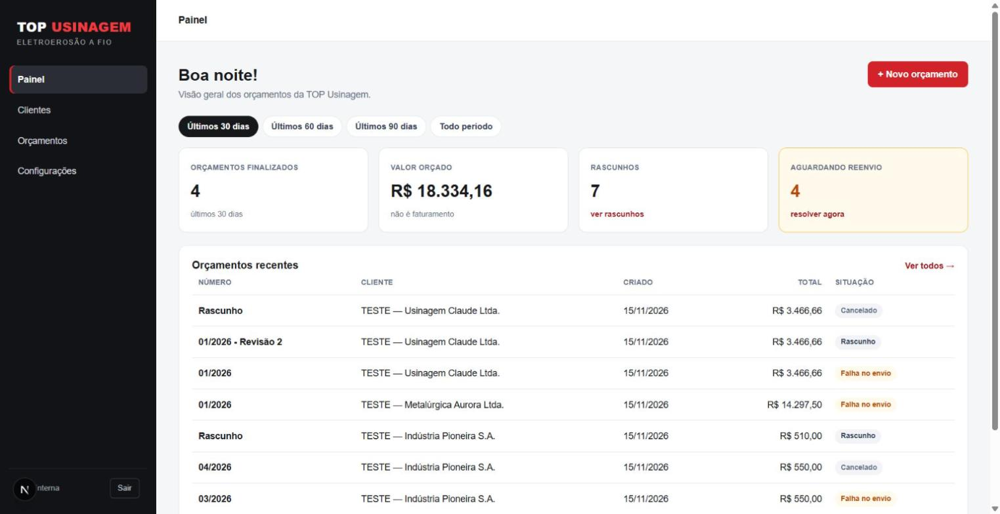
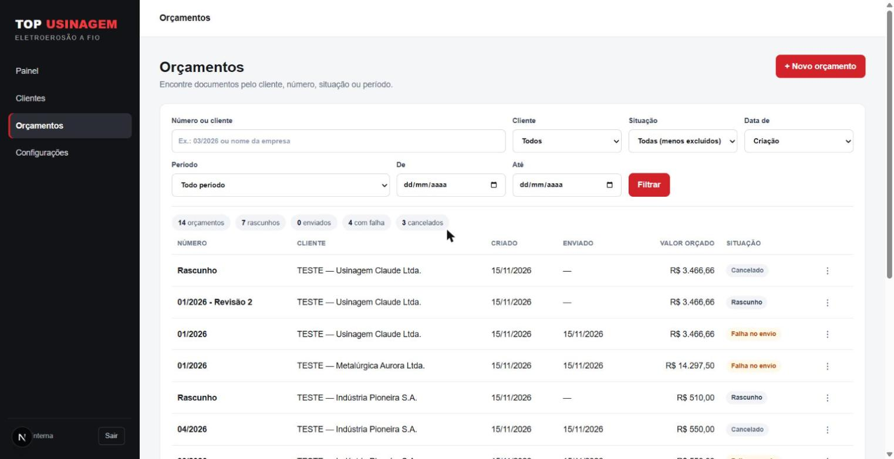
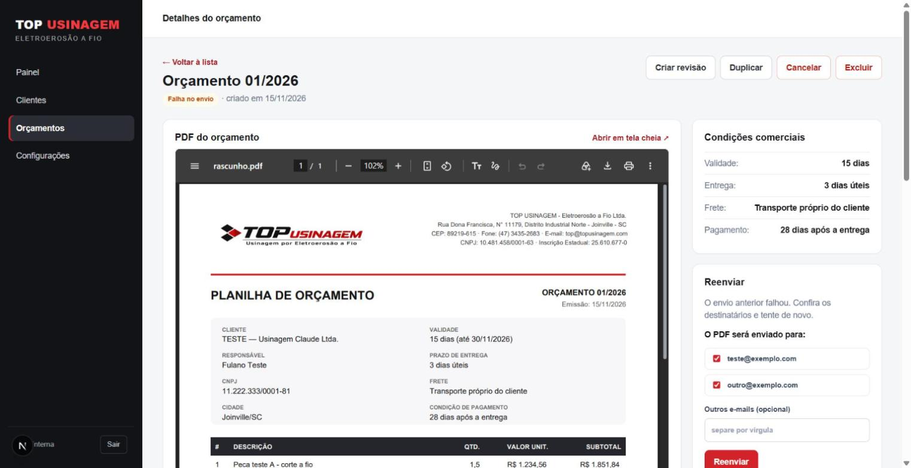
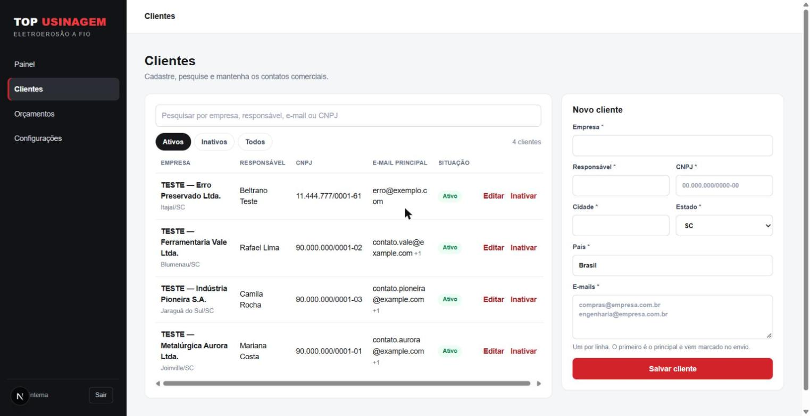
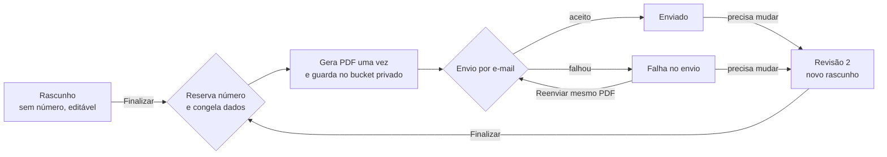

<div align="center">


# Sistema interno de clientes e orçamentos

Sistema web feito para a **TOP Usinagem – Eletroerosão a Fio** (Joinville/SC).<br />
A equipe cadastra clientes, monta orçamentos, gera o PDF oficial e envia por e-mail, tudo num só lugar.


</div>

<p align="center">
  
</p>

---

## O problema

Numa empresa de usinagem, o orçamento é a porta de entrada de todo pedido. E é aí que as coisas costumam se perder:

- **Numeração bagunçada.** Dois orçamentos com o mesmo número, ou um número pulado, e ninguém sabe qual vale.
- **Contas na mão.** Quantidade com casa decimal, frete, desconto em % ou em R$... um erro de digitação vira prejuízo ou cliente perdido.
- **Documento que muda depois de enviado.** O cliente tem uma versão e a empresa tem outra.
- **Histórico espalhado.** Para saber o que foi orçado para um cliente, é preciso caçar e-mails e arquivos.
- **Nenhuma visão geral.** Quanto foi orçado no mês? Quantos envios falharam? Quais rascunhos ficaram parados?

## A solução

Um sistema interno, acessado pelo navegador de qualquer lugar (empresa, casa ou celular). **Só entra quem foi convidado pela administração.**

| | O que o sistema garante |
|---|---|
| 🔢 | **Numeração automática e segura:** cada cliente tem sua sequência por ano (`Orçamento 01/2026`, `02/2026`...), protegida contra duplicação mesmo com duas pessoas finalizando ao mesmo tempo. |
| 🧮 | **Contas sempre certas:** a tela e o servidor usam a mesma função de cálculo. `1,5 × R$ 1.234,56` dá `R$ 1.851,84` na prévia, no banco e no PDF. |
| 🧊 | **Documento congelado:** ao finalizar, os dados do cliente e do orçamento são fotografados e o PDF é gerado **uma única vez**. Para mudar algo, cria-se uma **revisão** (`Orçamento 01/2026 - Revisão 2`). |
| 📄 | **PDF oficial com a identidade da empresa:** logo, dados comerciais, várias páginas com cabeçalho repetido, descrições longas quebradas em linhas. Rascunhos saem marcados como "SEM VALIDADE". |
| ✉️ | **Envio por e-mail com registro:** o usuário escolhe os destinatários, e cada envio fica no histórico (aceito pelo provedor, recusado ou com falha), com opção de reenviar. |
| 🗂️ | **Nada se perde:** exclusão reversível, cancelamento preservado no histórico e auditoria das ações importantes. |

## Funcionalidades

**Clientes**
- Cadastro com validação de CNPJ (dígitos verificadores), UF e vários e-mails (o primeiro é o principal)
- Busca instantânea por empresa, responsável, e-mail ou CNPJ, com ou sem pontuação
- Ativar e inativar (clientes com histórico nunca são apagados)
- Ficha do cliente com os últimos orçamentos e um atalho para criar um novo

**Orçamentos**
- Várias peças por orçamento, com subtotal ao vivo
- Validade por dias ou por data, prazo de entrega (1 a 5 dias úteis ou a combinar), frete CIF/FOB/transporte próprio, desconto em R$ ou %, condições de pagamento
- Prévia do documento antes de salvar, sem perder nada ao voltar para editar
- Estados: rascunho → enviado / falha no envio → cancelado / excluído (reversível)
- Revisões, duplicação e restauração
- Prévia do PDF embutida na tela do orçamento

**Painel e filtros**
- Indicadores por período (30, 60, 90 dias ou todo o período): orçamentos finalizados, valor orçado, rascunhos e envios aguardando reenvio
- Filtros feitos no banco por número, cliente, situação, período rápido ou datas, por data de criação ou de envio

**Qualidade de uso**
- Layout responsivo: no celular, o menu vira barra superior e os formulários ficam em uma coluna
- Botões ficam travados enquanto o servidor trabalha (sem finalizar duas vezes por clique duplo)
- Erros de preenchimento aparecem sem apagar o que foi digitado

## Telas

<table>
  <tr>
    <td></td>
    <td></td>
  </tr>
  <tr>
    <td align="center"><b>Orçamentos</b>: filtros e situação de cada documento</td>
    <td align="center"><b>Detalhe</b>: PDF oficial, condições e reenvio</td>
  </tr>
  <tr>
    <td colspan="2"></td>
  </tr>
  <tr>
    <td colspan="2" align="center"><b>Clientes</b>: busca instantânea e cadastro com validação</td>
  </tr>
</table>

<sub>As telas mostram apenas dados fictícios de teste.</sub>

## Como um orçamento nasce



## Arquitetura

```
Navegador ──► Next.js 16 (App Router, Server Components e Server Actions)
                 │
                 ├── proxy.ts ───────► renova a sessão e protege todas as páginas
                 ├── lib/quote-math ─► cálculo único (tela = servidor = PDF)
                 ├── lib/quote-pdf ──► PDF com jsPDF (comprimido, várias páginas)
                 └── lib/email ──────► SMTP via Nodemailer (bloqueado até liberação)
                 │
                 ▼
              Supabase
                 ├── Postgres + RLS ─► clientes, orçamentos, itens, logs e auditoria
                 ├── Função SQL ─────► reserva de número com trava (sem duplicar)
                 ├── Auth ───────────► acesso só por convite
                 └── Storage ────────► bucket privado "quote-pdfs"
```

| Camada | Tecnologia |
|---|---|
| Interface | Next.js 16, React 19, CSS próprio com design tokens (sem framework de UI) |
| Linguagem | TypeScript |
| Banco e autenticação | Supabase (PostgreSQL com Row Level Security e Auth) |
| Arquivos | Supabase Storage (bucket privado) |
| PDF | jsPDF |
| E-mail | Nodemailer (SMTP) |
| Hospedagem | Vercel, com deploy automático a cada push na `main` |

## Segurança

- **Sem cadastro público:** os usuários são convidados pela administração no Supabase Auth.
- **Row Level Security** ativa em todas as tabelas: só usuários autenticados leem e escrevem.
- **PDFs privados**, sem link público permanente. O download passa por uma rota que confere o login.
- **Nenhuma chave secreta no servidor:** o sistema usa só a chave pública do Supabase e a sessão do usuário. Credenciais ficam em variáveis de ambiente, nunca no código.
- **E-mail travado por padrão:** nada é enviado enquanto `EMAIL_SENDING_ENABLED` não for `true`.

## Rodando localmente

**Pré-requisitos:** Node.js 20+ e um projeto no [Supabase](https://supabase.com).

```bash
# 1. Instale as dependências
npm install

# 2. Configure as variáveis de ambiente
cp .env.example .env.local   # e preencha com os dados do seu projeto Supabase

# 3. Rode
npm run dev                  # http://localhost:3000
```

**Banco de dados:** no **SQL Editor** do Supabase, aplique na ordem os arquivos de [`supabase/migrations/`](supabase/migrations) (`0001`, `0002`, `0003`, `0004`). Depois, convide os usuários em **Authentication → Users**.

### Variáveis de ambiente

| Variável | Para que serve |
|---|---|
| `NEXT_PUBLIC_SUPABASE_URL` | Endereço do projeto Supabase |
| `NEXT_PUBLIC_SUPABASE_PUBLISHABLE_KEY` | Chave pública do Supabase |
| `SMTP_HOST`, `SMTP_PORT`, `SMTP_USER`, `SMTP_PASSWORD` | Servidor de e-mail |
| `SMTP_FROM` | Remetente dos orçamentos |
| `EMAIL_SENDING_ENABLED` | `true` libera o envio real (padrão: desligado) |

### Comandos

| Comando | O que faz |
|---|---|
| `npm run dev` | Servidor de desenvolvimento |
| `npm run build` | Build de produção |
| `npm run lint` | Verificação de código |

## Estrutura

```
app/
├── page.tsx               # Login
├── dashboard/             # Painel com indicadores
├── clientes/              # Lista, busca, cadastro e ficha do cliente
├── orcamentos/            # Editor, lista com filtros, detalhe, edição e ações
├── configuracoes/         # Situação do e-mail e regras do sistema
├── api/orcamentos/[id]/pdf/  # Entrega do PDF (só com login)
└── components/            # Menu, layout e botões compartilhados
lib/
├── quote-math.ts          # Cálculos de valores (fonte única)
├── quote-pdf.ts           # Geração e armazenamento do PDF
├── email.ts               # Envio SMTP
├── br.ts                  # CNPJ, UF e e-mails
└── format.ts              # Moeda, datas e rótulos em português
supabase/migrations/       # Esquema do banco, políticas e funções
proxy.ts                   # Sessão e proteção das rotas
```

## Fora do escopo (por enquanto)

O foco é clientes e orçamentos. Estoque, produção, emissão fiscal, contas a pagar e receber e portal do cliente ficam para fases futuras.

---

<div align="center">
<sub>Desenvolvido por <a href="https://github.com/victordosanjos1">victordosanjos1</a> para a TOP Usinagem – Eletroerosão a Fio.</sub>
</div>
